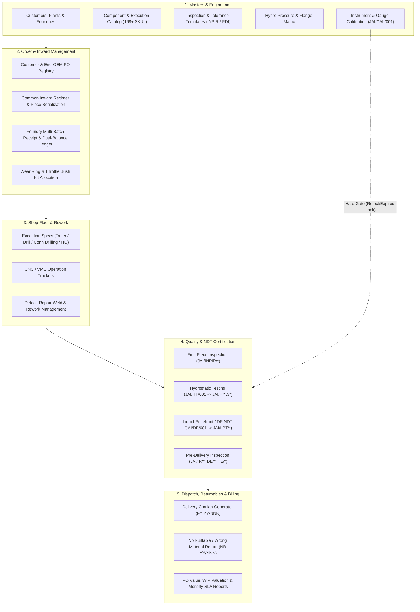

# Jai Engineering & Repairing Works — ERP System Documentation Index & Executive Overview

> **Document ID:** `DOC-00`  
> **Target System:** Jai Engineering Job-Work Manufacturing & Quality ERP  
> **Target Tech Stack:** Next.js 16 (`16.4.6`) · React 19 (`19.3.0`) · TypeScript · Tailwind CSS v4 · PostgreSQL  
> **Source Basis:** Comprehensive analysis of all 184 Excel workbooks, 6 historical ZIP archives, inspection formats (`JAI/*`), and registers inside `Jai-Engineering/`.

---

## 1. Company Profile & Business Context

| Attribute | Observed Client Details |
| :--- | :--- |
| **Legal / Trade Name** | M/s Jai Engineering & Repairing Works |
| **Works Address** | Gat No. 505, A/Post Palshi, Shirwal, Tal. Khandala, Dist. Satara – 412801, Maharashtra, India |
| **Legacy / Office Reference** | Pune – 411033 (appears on legacy `JAI/IR/004`–`005` headers; canonical plant is Palshi, Shirwal) |
| **GSTIN** | `27AAPFJ7138K1ZQ` |
| **Contact Numbers** | `9082965176` / `9226784256` / `9822567908` |
| **Official Email** | `jaiengineering123@rediffmail.com` |
| **Core Business Model** | Precision CNC / VMC Job-Work Machining, Execution Modification, Non-Destructive Testing (LPT/DP), Hydrostatic Pressure Testing, Wear-Ring / Throttle-Bush Fitment, and Repair-Weld Re-machining of industrial pump castings and bearing assemblies. |

### Value Chain Position
Jai Engineering operates as an **authorized precision finishing & quality-certification job-work partner** for major centrifugal and multistage pump manufacturers. Customers supply **raw or semi-finished castings** (under job-work Purchase Orders); Jai Engineering never purchases the primary casting metal—it bills strictly for **machining, execution, fitment, and testing services** per piece (`RATE`), while maintaining strict 100% piece-level metallurgical and dimensional traceability (Heat No., Pattern Code, RT No., IN Code, Serial No.) back to the customer and end OEM.

---

## 2. Supply Chain Ecosystem (Customers & Intermediaries)

Analysis of every workbook and report across `Jai-Engineering/` reveals **two distinct customer plant divisions** plus **foundry intermediaries** acting on behalf of the end OEM:

1. **KSB Limited — Energy Projects Division (EPD), Shirwal** (`SHIRWAL`, Khandala MIDC – 412802)
   - **Relationship:** Direct Job-Work Customer.
   - **Scope:** Full range of 18+ component families (`Volute Casing`, `Suction Casing`, `Discharge Casing`, `Stage Casing` [Taper / Drill / Bleed-off / Turn+Drill / Remachining], `Bearing Housing`, `Bearing Bracket`, `Bearing End Cover`, `Casing Cover`, `Diffuser Plate`, `Guide Casing`, `Stuffing Box`, `Foot`, `Thrust Bearing Housing`, `Discharge Cover`, `Pump Bracket`, `Locking Ring`).
   - **Series Covered:** `RPH`, `RPHB`, `RPHV`, `RPHD`, `CPK`, `WKT`, `WKTR`, `WKB`, `HDA`, `HDB`, `HG2`, `HG3`, `KNPMS`, `RHMRI`, `DVMX`, `CHTR4`, `QG`, `SYT`, `HPH`.

2. **KSB Limited — Power Project Division (PPD), Chinchwad** (`CHINCHWAD`, D-II Block, MIDC, Chinchwad, Pune – 411019)
   - Operates through **two distinct procurement channels**:
     - **Channel A — Direct KSB Chinchwad POs** (tracked inside `KSB DETAILS`, `COMPANY = CHINCHWAD`): Direct machining of `Bearing Housing` (`HDA 50`, `HDA 65`, `HDB 125`, `HG 1-2`, `HG2`, `MC DVMX`, `MC DVMX DE`, `MC DVMX NDE`, `CHTR4`) and direct `Suction Casing` (`HDA 50`, `HDA 65`, `HDA 100`).
     - **Channel B — Foundry-Mediated 3-Party POs** (tracked in `JSONS PO ` / `JSONS SUMMERY` and PDI folders):
       - **JSONS Foundry Pvt. Ltd., Sangli** (`G12/1, G13, G2/B, Kupwad Block, Sangli – 416436`): Supplies rough castings against **KSB Chinchwad POs** specifically for **`HDA 50`, `HDA 65`, `HDA 80`, `HDA 80 ENL`, and `HDA 100` Suction & Discharge Casings** (`WCB`, `CA6NM`). Jai receives castings from JSONS in partial challan batches, manages repair-weld cycles with JSONS/in-house, tests (Hydro & LPT), and dispatches finished casings back to JSONS citing **both** KSB PO and JSONS Challan/PO.
       - **Maind Flow Controls Pvt. Ltd.**: Observed in `DISCHARGE CASING WL 80-26-27.xlsx` (`25/JW36/1..5` mapped to KSB POs `4507420111/10`, `4507374630/10`) operating with the exact same **foundry-mediated 3-party PO** model for `WL`/`WK` series castings.

---

## 3. High-Level ERP Module Map

---

## 4. ERP Documentation Suite Index

| Doc # | File | Focus Area & Audience |
| :--- | :--- | :--- |
| **00** | [00-INDEX-AND-EXECUTIVE-OVERVIEW.md](file:///d:/Jai%20Engineering/jai-engineering/project-data/00-INDEX-AND-EXECUTIVE-OVERVIEW.md) | Executive summary, company profile, supply-chain overview, glossary, legacy Excel normalization rules. |
| **01** | [01-BUSINESS-FLOWS-AND-OPERATIONS.md](file:///d:/Jai%20Engineering/jai-engineering/project-data/01-BUSINESS-FLOWS-AND-OPERATIONS.md) | Complete PO-to-Dispatch state machines for KSB Shirwal, KSB Chinchwad, JSONS/Maind Flow 3-party flows, sub-components, split flange confirmations, rework & returnables. |
| **02** | [02-PRODUCT-AND-COMPONENT-MASTER-CATALOG.md](file:///d:/Jai%20Engineering/jai-engineering/project-data/02-PRODUCT-AND-COMPONENT-MASTER-CATALOG.md) | Exhaustive product & variant taxonomy (18+ categories, 168+ sizes), materials, flange ratings, execution rules, Hydro test matrix, drawing & IN-code mapping. |
| **03** | [03-QUALITY-INSPECTION-AND-REPORTS-SPEC.md](file:///d:/Jai%20Engineering/jai-engineering/project-data/03-QUALITY-INSPECTION-AND-REPORTS-SPEC.md) | Detailed field specs, formulas, tolerance rules, instrument mappings, and layouts for `INPIR`, `PDI`, `Hydro`, `LPT`, `Calibration`, `DC`, `ST/008`, `ST/008A`, `Rework %`. |
| **04** | [04-DATABASE-SCHEMA-AND-DATA-MODEL.md](file:///d:/Jai%20Engineering/jai-engineering/project-data/04-DATABASE-SCHEMA-AND-DATA-MODEL.md) | Normalized PostgreSQL relational schema, Mermaid ERD, piece-level genealogy, triggers/constraints, and Excel ETL migration mappings. |
| **05** | [05-SYSTEM-ARCHITECTURE-AND-API-SPEC.md](file:///d:/Jai%20Engineering/jai-engineering/project-data/05-SYSTEM-ARCHITECTURE-AND-API-SPEC.md) | Next.js 16 + TypeScript + PostgreSQL architecture, RBAC roles, FY document numbering engine, Server Actions / REST API contracts, PDF/Excel automation, validation gates. |
| **06** | [06-UI-UX-SCREENS-AND-IMPLEMENTATION-ROADMAP.md](file:///d:/Jai%20Engineering/jai-engineering/project-data/06-UI-UX-SCREENS-AND-IMPLEMENTATION-ROADMAP.md) | Screen-by-screen UI/UX wireframes, shop-floor inspection entry ergonomics, KPI dashboards, and 5-phase implementation & UAT roadmap. |

---

## 5. Domain Glossary & Legacy Data Normalization

### 5.1 Industry & Client Terminology
- **IN Code (`IN071289`, `O5438632`, etc.)**: KSB's SAP finished/machined material master code. Note: Codes starting with `IN...` and `O5...`/`05...` are both KSB material/item identifiers depending on part/plant.
- **Raw Code**: KSB's semi-finished / raw casting material code before Jai Engineering's machining operation.
- **Heat No / Heat Code (e.g., `E 13972`, `F 11646`, `O1D25`, `R5662`)**: Foundry melt batch number stamped on every casting; mandatory on Delivery Challans, PDI, Hydro, and LPT certificates for metallurgy traceability.
- **P.C. (`P.C. - L00082`)**: Pattern Code / Foundry casting pattern identifier printed on JSONS Delivery Challans.
- **RT No (`RT NO`)**: Radiography Test reference number supplied at casting inward for pressure-retaining nuclear/high-class castings (`WCB`, `CA6NM`).
- **Execution Drawing (`EXE DRG`, e.g. `IP16409-37D`, `P123346D PAGE2`, `P089185C`)**: Secondary machining drawing specifying variant-specific features (stage casing taper angle/depth, balance holes, connection drilling ports `A/B/D/E`, or `HG` casing bore/hole variants) overlaid on the base casting drawing.
- **Connection Drilling (`A`, `A+D`, `A+B+D`, `A+E`, `IV`)**: Port tapping/drilling configuration required on Volute Casings.
- **WR / Throttle (`WEAR RING`, `THROTTLE BUSH`)**: Mating replaceable bush/ring sub-components supplied/checked alongside `Volute Casing` or `Casing Cover` for shrink/press fitment and final boring.
- **CL2B / CL3 (`CLASS`)**: Customer quality/NDT acceptance classification on KSB POs (`CL2B` requires stricter pressure/NDT compliance for steel `WCB`/`CA6NM`; `CL3` applies to `FG260` cast iron).
- **NB Challan (`NB-26/001`, `SAME CHALLAN`)**: Non-Billable / Returnable Gate Pass used when returning defective, unmachinable, or wrongly sent castings (`WRONG MATERIAL`) to KSB without invoicing.
- **ULR No**: Unique Lab Report number on NABL-accredited external calibration certificates for Jai Engineering's inspection gauges.

### 5.2 Legacy Excel Header Normalization Map
Current client Excel workbooks contain spelling inconsistencies and composite text fields that the ERP **must normalize cleanly in UI & DB** while supporting flexible Excel import:

| Legacy Excel Spelling / Field | Canonical ERP Field Name | Target DB Table / Column |
| :--- | :--- | :--- |
| `FORMATE NO` | Format Number | `report_templates.format_code` |
| `DISCRIPTION` / `ITEM DISCRIPTION` | Item Description / Category | `component_masters.category_name` |
| `MATEIAL` | Material Grade | `material_grades.code` |
| `THROTAL FITTMENT` / `THROTAL AVLABILITY` | Throttle Bush Fitment Required / Available | `inward_items.throttle_fitment_req`, `throttle_available` |
| `EXICUTION` / `TAPER EXICUTION` | Execution / Taper Execution | `execution_specs.execution_type` |
| `SURRESION` / `RACE FACE` | Serration (Spiral) / Raised Face | `flange_specs.finish_type`, `raised_face_od` |
| `QTY RECEIVED FOM JSONS` | Qty Received from Foundry | `foundry_po_lines.total_received_qty` |
| `SUMMERY` | Summary | Dashboard Views |
| `OBERVATION` / `NACHINE NO` / `TAPPIMG` / `THICHNESS` | Observation / Machine No / Tapping / Thickness | `inspection_parameters` / `observations` |
| `ENERGY PROTECTS DIVISION` | Energy Projects Division | `customer_plants.division_name` |
| `RECEVERS SIGNATURE` | Receiver's Signature | Delivery Challan Print Layout |
| `2029-01-05`, `2006-11-19` (Excel entry typos) | Validated Inward / Challan Date | Import validator flags >±90 day FY anomaly |
