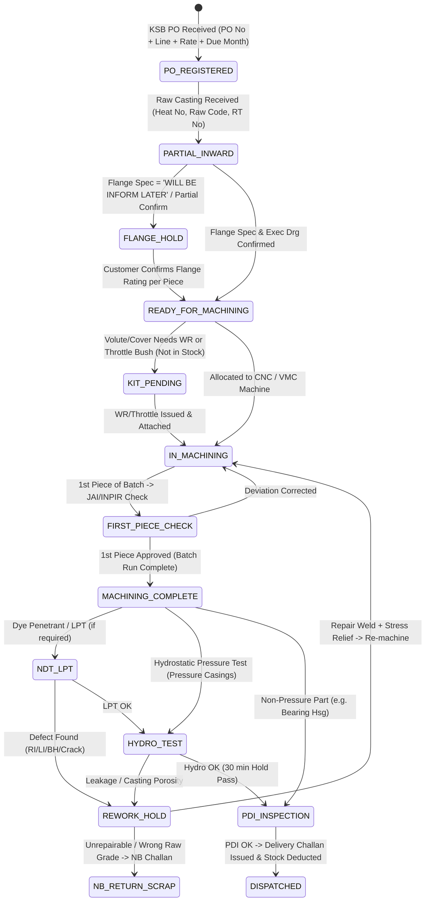
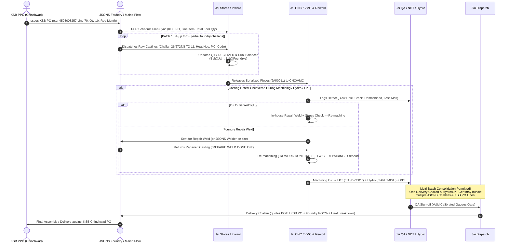

# End-to-End Business Flows & Operational Workflows

> **Document ID:** `DOC-01`  
> **Scope:** Complete PO-to-Dispatch lifecycle, multi-party supply chain routing, dual-balance accounting, kit allocation, rework/repair-weld loops, split confirmations, and returnable challans.

---

## 1. Comparative Overview of Procurement & Job-Work Flows

Jai Engineering handles **three primary operational pipelines** depending on the Customer Plant and whether a Foundry acts as an intermediary:

| Dimension | Flow 1: KSB Shirwal Direct | Flow 2: KSB Chinchwad Direct | Flow 3: Foundry-Mediated (JSONS / Maind Flow -> KSB Chinchwad) |
| :--- | :--- | :--- | :--- |
| **End OEM** | KSB Ltd. – EPD, Shirwal | KSB Ltd. – PPD, Chinchwad | KSB Ltd. – PPD, Chinchwad |
| **Billing / Contract Party** | KSB Limited (Shirwal) | KSB Limited (Chinchwad) | JSONS Foundry Pvt. Ltd. (Sangli) / Maind Flow Controls Pvt. Ltd. |
| **Primary PO Reference** | KSB PO (`4507...` / `4508...`) | KSB PO (`4507...` / `4508...`) | **Dual PO**: KSB End PO (`4508... / line`) **AND** Foundry PO / Challan Batch (`26/6727/8 TO 11` or `25/JW36/1..5`) |
| **Product Scope** | All 18+ categories (`Volute`, `Stage`, `Suction`, `Discharge`, `Bearing Hsg`, `Casing Cover`, `Diffuser`, `Guide`, `Stuffing Box`, etc.) | Primarily `Bearing Housing` (`HDA`, `HDB`, `HG`, `MC DVMX`, `CHTR4`) & Direct `Suction Casing` (`HDA 50/65/100`) | Strictly `Suction Casing` & `Discharge Casing` (`HDA 50`, `HDA 65`, `HDA 80`, `HDA 80 ENL`, `HDA 100` for JSONS; `WL 80` for Maind Flow) |
| **Raw Material Receipt** | Direct KSB Challan (1 batch or staggered per PO) | Direct KSB Challan | **Up to 5+ partial Foundry Challan batches** mapped against a single KSB PO line (`Batch 1..N`) |
| **Balance Tracking** | Single Balance (`Received - Dispatched`) | Single Balance (`Received - Dispatched`) | **Dual Balance**: (1) `Bal Qty at Jai = Rec - Disp` AND (2) `Bal Qty from Foundry = KSB Line Qty - Rec` |
| **Defect / Rework Ownership** | Return via `NB` Challan or KSB-authorized repair | Return via `NB` Challan or KSB-authorized repair | **Foundry Rework Loop** (`JSONS REWORK DETAILS`): Blow hole / Crack / Less Material logged -> Repair Weld (`JSONS` or `IH`) -> Re-machine -> Re-test |
| **Dispatch Consignee** | KSB Ltd., Shirwal | KSB Ltd., Chinchwad | JSONS Foundry Pvt. Ltd. / Maind Flow Controls (quoting both POs + Heat breakdown) |
| **Mandatory QC Pack** | First Piece (`INPIR`) + PDI (`IR`/`DE`/`TE`) + Hydro (pressure parts) + LPT (if CL2B/specified) | First Piece + PDI + Hydro (for Suction Casings) + LPT | PDI (Client = Foundry) + Hydro Test Cert + LPT Cert (100% on `CL2B` `WCB`/`CA6NM` HDA casings) |

---

## 2. Flow 1 & Flow 2: Direct Customer Flow (KSB Shirwal & KSB Chinchwad)

### 2.1 High-Level State Machine

### 2.2 Step-by-Step Operational Rules (Observed in `KSB DETAILS` & `OVERALL COMMON INWARD REGISTER`)
1. **PO Capture (`KSB DETAILS`, Format `JAI/ST/008`)**:
   - Captures `COMPANY` (`SHIRWAL` or `CHINCHWAD`), `PO NO` (e.g. `4507892310` or `4508281688/10`), `PO DATE`, `DESCRIPTION`, `SIZE`, `KSB DESPATCH MONTH` (SLA target date), `FLANGE DETAILS`, `DRAWING NO` + `REV`, `IN CODE`, `MATERIAL`, `CLASS`, `RATE` (job-work rate in ₹ per unit).
   - **Rule — Split Flange Confirmation**: A single PO line of qty 5 may have mixed flange states (e.g., PO `4508276641` in `KSB DETAILS` R549: `"DIN2533 PN16 - 1 NOS, REMAINING TO CONFIRM"`). The ERP **must track flange specification at the individual piece/allocation level** and block final CNC flange finishing on unconfirmed pieces (`FLANGE_HOLD`) while allowing confirmed pieces to finish and dispatch.
2. **Casting Inward (`OVERALL COMMON INWARD REGISTER`)**:
   - Store logs `INWARD DATE`, `KSB CH NO` & `CH DATE`, `INWARD QTY`, `HEAT NO`, `RAW CODE`, `RT NO`, `IN CODE`, `PRIORITY` (`P1`, `P2`, `P3`, `URGENT`), and internal `STATUS` (`P` = Pending, `COMP` = Completed, `DISP` = Dispatched).
   - **Wrong Material Check at Inward/Pre-Machining**: Store/Operator verifies physical casting shape & grade against Drawing/PO before machining (e.g. `KSB DETAILS` R454: *Required `WK/WL` type, received `HDA` type*; `Sheet3` NB rows: *Required `GR 2A`, received `WCB`*; *Required `HDA 100 150#`, received wrong flange casting*). Wrong castings are routed immediately to **Non-Billable Return (`NB-YY/...`)** with ₹0 billing.
3. **Component-Specific Execution Parameter Assignment**:
   - **Volute Casing (`RPH`, `RPHB`, `RPHV`, `CPK`)**: Assigns `CONNECTION DRILLING` (`A`, `A+D`, `A+B+D`, `A+E`, `A+B+E`, `IV`, etc.), `WEAR RING SIZE` + availability + `WR IN CODE`, and `THROTTLE FITMENT` + availability + `THROTTLE IN CODE`.
   - **Stage Casing (`HDA`, `HDB`, `WKT`)**: Assigns Execution Type (`Taper Execution` with `TAPER SIZE` `0.06`–`0.21` + `EXE DRG NO`; `Drill Execution` with `NO OF HOLES` `1`/`2` & `DRILL DIST` `28`/`30`/`35`; `Bleed Off`; `Turn + Drill`; `Remachining`).
   - **HG2 / HG3 Casings**: Assigns `NO OF HOLES FOR HG`, `BORE DIA FOR HG`, and overlay execution drawing (e.g., `EXE-06 DRG NO P089185C`).
4. **Machining & Shop-Floor Trackers**:
   - Dedicated production logs exist for complex multi-setup items (`VOLUTE CASING MACHINING DETAILS`, `WKT SUC AND DIS MACHINING DETAILS`, `taper exicution stage casing`), recording machine ID (`CNC`, `VMC`, `Milling`), stage start/end, operator, and inward->dispatch cycle time.
5. **Quality & Dispatch**:
   - Every dispatched lot generates a **PDI Report** (`2026-27/NNN`), **Hydro Test Certificate** (`JAI/HYD/2026-27/NNN`, if pressure-containing), **LPT Certificate** (`JAI/LPT/2026-27/NNN`, if specified), and **Delivery Challan** (`26/NNN`).
   - Financial updates trigger automatically: `AMOUNT RECEIVED = QTY RECEIVED * RATE`, `AMOUNT DISPATCHED = QTY DESPATCH * RATE`, `BAL QTY = QTY RECEIVED - QTY DESPATCH`, `BALANCE AMOUNT = BAL QTY * RATE`.

---

## 3. Flow 3: Foundry-Mediated 3-Party Flow (JSONS Foundry / Maind Flow -> KSB Chinchwad)

### 3.1 Critical Business Rules of the Foundry Flow (`JSONS PO ` Format `JAI/ST/008A`)
1. **Master Record Anchor = `(KSB PO NO, LINE ITEM NO)`**:
   - One KSB PO (e.g., `4508008257`) has multiple line items (`10`, `20`, ..., `150`) covering mixed sizes/flanges/months.
   - Jai records `QTY AS PER KSB LINE ITEM NO` and `REQUIRED MONTH BY KSB` **upfront**, even before JSONS sends raw castings.
2. **Staggered Multi-Batch Receipts (Eliminating Excel's 5-Batch Limit)**:
   - Excel tracks Batch 1..5 in horizontal columns `X..AI` (`QTY RECEIVED`, `CH NO`, `DATE`). The ERP models this as a **1-to-Many `foundry_inward_batches` child table** allowing unlimited partial challans (`26/6727/8 TO 11`, etc.) to accumulate into `total_received_qty`.
3. **Dual Balance Accounting**:
   - **Shop Floor Stock (`BAL QTY FROM JAI`)** = `SUM(Foundry Receipt Batches) - SUM(Dispatched Qty)` -> Cannot go negative; measures castings physically inside Jai's plant (`32 NOS`, `₹2,18,478` WIP in sample snapshot).
   - **Pending Foundry Supply (`QTY BAL FROM JSONS`)** = `KSB Line Item Qty - SUM(Foundry Receipt Batches)` -> Alerts Purchasing/Coordinator that JSONS still owes raw castings (`6 NOS` pending in sample snapshot) to meet KSB's `REQUIRED MONTH`.
4. **FY Roll-Over Carry-Forward Logic**:
   - Observed in `JSONS PO `: `ACTUAL DISPATCHED FROM 01-04-2026 = Total Dispatched - Prior FY Carryover` (row `Q1=13`, tracking work carried across the April 1 Indian Financial Year boundary). The ERP separates **PO Lifecycle Cumulative Balance** from **Financial-Year Dispatch Volume/Revenue**.
5. **Multi-PO / Multi-Batch Consolidation at Testing & Dispatch**:
   - Verified in `DELIVERY CHALLAN JAI ENGG.xlsx` (`26/315`), `HYDRO TEST` (`JAI/HYD/2025-26/210`), and `LPT` (`JAI/LPT/2026-27/392`): A single Delivery Challan of 5 castings (`Suction Casing HDA 80`) can fulfill pieces across **two KSB POs** (`4508008257/70,80,90` + `4508036075/10`) and **four distinct Heat Nos** (`E 13972 - 1`, `E 13974 - 1`, `F 11646 - 2`, `F 11767 - 1`).
   - Similarly, Hydro/LPT certificates frequently aggregate multiple Foundry Challan batches (`25/19794/6`, `25/22352/22`, `25/23452/12,13`) into one test batch if they share Component Size + Material + Test Pressure.
6. **Monthly Delivery SLA Matrix (`Sheet1`: `MONTH WISE BALANCE QTY`)**:
   - Coordinators view pending balance grouped by `(Type [Suction/Discharge], Size [HDA 50..100 / 80 ENL], Material [WCB/CA6NM], Flange Rating [150#/600#/900#]) × Commitment Month` to schedule CNC bottlenecks ahead of KSB Chinchwad due dates.

---

## 4. Sub-Component Fitment Workflow (Wear Rings & Throttle Bushes)

Observed in `OVERALL COMMON INWARD REGISTER` and `VOLUTE CASING` reports:
- **Trigger**: Certain `Volute Casing` (`RPH`, `RPHB`, `CPK`, `RPHV`) and `Casing Cover` drawings specify shrunk-fit **Wear Rings (WR)** and/or **Throttle Bushes**.
- **Two Allocation Attributes**:
  1. `WR / Throttle Required?` (`YES/NO` + Target Size e.g. `255.1 / 255.2`, `115`, `248.3` + `WR/Throttle IN Code` + Drawing).
  2. `WR / Throttle Availability?` (`YES` / `NO` / `PENDING FROM KSB`).
- **Operational Blocking Rule**:
  - Semi-finished turning/drilling of the Volute Casing can proceed, **but final casing fitment and PDI clearance cannot occur** until the matching `WR` / `Throttle Bush` is received from KSB (against its `WR IN CODE`), pressed/fitted, and finish-bored to tolerance.
  - System must flag any casting waiting >3 days in `"MACHINED – WAITING FOR WR/THROTTLE"` on the Supervisor Dashboard.

---

## 5. Defect, Repair-Weld & Rework Workflow

Casting quality issues are an enormous operational reality at Jai Engineering—especially on `HDA` steel/martensitic castings (`WCB`, `CA6NM`), where historical **`YEARLY REWORK PERCENTAGE`** averaged **17.65% to 38.91%** (`Nov 22–Mar 23`: 48/272 = `17.65%`; `FY 23–24`: 159/566 = `28.09%`; `FY 24–25`: 307/789 = `38.91%`; `FY 25–26`: 132/416 = `31.73%`).

### 5.1 Defect Taxonomy (from `JSONS REWORK DETAILS.xlsx`, `LPT`, `DIFFUSER PLATE`, `KSB`)
- **Surface / Foundry Porosity**: `Blow hole (BH)`, `Pin holes / Pitting`, `Porosity`, `Shrinkage`
- **Structural / NDT Failure**: `Crack`, `RI` (Rounded Indication e.g. `RI 5-8MM / 3 NOS FACE`), `LI` (Linear Indication e.g. `LI 1-50 MM`), `Leakage in Hydro` (e.g. flange/body/tapping `M12 TAP` weep)
- **Dimensional / Stock Errors**: `Heavy Unmachined portion`, `Less material / Under-size`, `Core shift / Wall thickness mismatch`, `Sealing face damage marks`

### 5.2 Multi-Cycle Repair & Rework Lifecycle
1. **Defect Logged**: Operator or QA/NDT Engineer flags affected Piece Serial No (`JAI/...`), Heat No, Component, Defect Type, and Location (e.g., `"BH at face, 380 ID"`). Piece status -> `DEFECT_REPORTED`.
2. **Disposition Decision**:
   - **In-House Repair (`IH`)**: Authorized minor weld buildup done internally; records `REPAIR WELD DATE`, welder/method.
   - **External / Foundry Repair**: Casting sent to JSONS / foundry welder; tracks `SENT FOR WELD DATE` and `REPAIR WELD DONE ON` return date.
   - **Returnable Rejection (`NB`)**: Major crack, unrepairable hydro failure, or wrong alloy grade -> routed to Non-Billable Challan (`NB-YY/NNN`).
3. **Post-Weld Re-machining**: Piece re-enters CNC/VMC; records `REWORK DONE DATE` and increments `repair_cycle_count`. If `repair_cycle_count >= 2`, explicitly flags **`TWICE REPAIRING DONE`** (high-risk casting alert for QA & KSB notification).
4. **Mandatory Re-Certification**: Any repaired pressure boundary casting **must** re-pass both **LPT** (`JAI/DP/001`) and **Hydrostatic Testing** (`JAI/HT/001`) before PDI approval.

---

## 6. Non-Billable / Returnable Dispatch Flow (`NB-YY/...` & `SAME CHALLAN`)

Observed in `KSB LTD 2026-2027.xlsx -> Sheet3` (9 documented return cases):
- **Triggers**:
  1. Wrong material grade delivered (e.g., `WCB` sent for `GR 2A` order `P65976-00`, `KNPMS` wrong casting).
  2. Wrong casting geometry/series (e.g., `HDA` sent for `WK/WL` PO, or wrong flange blank on `HDA 100 150#`).
  3. Unmachinable casting (`LESS MATERIAL` in bore/flange/width, `CORE SHIFT`, `EXCESS UNCLEANED/DAMAGED`).
  4. Rejected in Hydro / LPT after machining (when customer bears casting scrap).
- **Document & Balance Rules**:
  - Generates Challan series **`NB-YY/NNN`** (or references **`SAME CHALLAN`** if returned immediately on customer's incoming vehicle/challan).
  - Deducts physical `BAL QTY` from Jai's shop-floor stock (`QTY RETURNED / SCRAP` tracked separately from `QTY DESPATCHED BILLABLE` so **`AMOUNT DISPATCHED = ₹0`** for returns—fixing a major audit blindspot in Excel!).

---

## 7. Calibration Gate & Certificate Sign-Off Control

Observed in `CALIBRATION RECORD FOR INSPECTION INSTRUMENT.xlsx` (`JAI/CAL/001`):
- All 46+ gauges (`OM`, `BG`, `D`, `VC`, `DV`, `HG`, `DEVP`, `PRE`, `WG`, `SP`, `IM`) have `CALIBRATION DATE`, `DUE DATE`, `ULR CERTIFICATE NO`, and `STATUS` (`ACTIVE` vs `REJECT`—e.g. `JAI/PRE/03` & `JAI/PRE/06` are explicitly marked `REJECT`).
- **Automated Hard Gates in ERP**:
  1. **Hydro Certificate Creation**: Only `ACTIVE` Pressure Gauges (`JAI/PRE/08`, `JAI/PRE/12`, etc.) with `Calibration Due Date >= Test Date` and range >= `Test Pressure × 1.25` (or within certified working band) can be selected; `REJECT` or expired gauges are **disabled/blocked**.
  2. **PDI / INPIR Observation Entry**: Master instrument IDs (`VC`, `OM`, `BG`, `DV`, `IM`) auto-validate calibration currency on inspection date and warn/block sign-off if a critical bore gauge/micrometer is expired.
