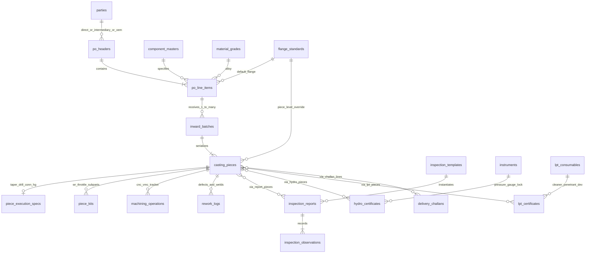

# Database Schema, Data Model & Legacy Excel Migration Spec

> **Document ID:** `DOC-04`  
> **Target Engine:** PostgreSQL 16+ (compatible with Prisma / Drizzle ORM)  
> **Design Principle:** Piece-level metallurgical & dimensional genealogy (`casting_pieces`) decoupled from PO accounting (`po_line_items`) and multi-batch inward receipts (`inward_batches`), supporting consolidated multi-PO/multi-heat dispatch and split flange specifications.

---

## 1. Entity-Relationship Architecture (Mermaid ERD)



---

## 2. Core PostgreSQL DDL Specification

### 2.1 Enumerations (`CREATE TYPE`)

```sql
CREATE TYPE party_role AS ENUM ('OEM_PLANT', 'FOUNDRY_INTERMEDIARY', 'BOTH');
CREATE TYPE procurement_flow_type AS ENUM ('DIRECT', 'FOUNDRY_MEDIATED');
CREATE TYPE piece_status AS ENUM (
    'RECEIVED',
    'FLANGE_HOLD',
    'KIT_PENDING',
    'READY_FOR_MACHINING',
    'IN_MACHINING',
    'FIRST_PIECE_PENDING',
    'MACHINING_COMPLETE',
    'REWORK_HOLD',
    'WAITING_FOR_WELD',
    'WELD_COMPLETE_REWORK',
    'LPT_PASSED',
    'HYDRO_PASSED',
    'PDI_PASSED',
    'DISPATCHED',
    'RETURNED_NB',
    'SCRAPPED'
);
CREATE TYPE instrument_status AS ENUM ('ACTIVE', 'DUE_SOON', 'EXPIRED', 'REJECT', 'UNDER_REPAIR');
CREATE TYPE report_kind AS ENUM ('FIRST_PIECE', 'PDI_STANDARD', 'PDI_DRILL_EXE', 'PDI_TAPER_EXE');
CREATE TYPE challan_kind AS ENUM ('JOB_WORK_REGULAR', 'NON_BILLABLE_RETURN', 'SAME_CHALLAN_RETURN');
CREATE TYPE defect_disposition AS ENUM ('IN_HOUSE_WELD', 'FOUNDRY_WELD', 'RE_MACHINE_ONLY', 'RETURN_NB', 'SCRAP');
```

### 2.2 Master Domain Tables

```sql
-- Customers, Plants (KSB Shirwal / Chinchwad), and Foundries (JSONS / Maind Flow)
CREATE TABLE parties (
    id              UUID PRIMARY KEY DEFAULT gen_random_uuid(),
    code            VARCHAR(32) UNIQUE NOT NULL,       -- e.g. KSB_SHIRWAL, KSB_CHINCHWAD, JSONS, MAIND_FLOW
    legal_name      VARCHAR(180) NOT NULL,             -- e.g. M/s JSONS FOUNDRY PVT LTD
    division_name   VARCHAR(120),                      -- e.g. ENERGY PROJECTS DIVISION
    role            party_role NOT NULL,
    address_line1   TEXT NOT NULL,
    city_pin        VARCHAR(80) NOT NULL,
    gstin           VARCHAR(20),
    is_active       BOOLEAN NOT NULL DEFAULT TRUE,
    created_at      TIMESTAMPTZ NOT NULL DEFAULT NOW()
);

CREATE TABLE material_grades (
    id              SERIAL PRIMARY KEY,
    code            VARCHAR(32) UNIQUE NOT NULL,       -- WCB, CA6NM, FG260, CF8M, CF3M, LCB, GR 2A, etc.
    alloy_family    VARCHAR(64) NOT NULL,
    default_class   VARCHAR(16),                       -- CL2B, CL3
    requires_lpt_by_default BOOLEAN NOT NULL DEFAULT FALSE
);

CREATE TABLE flange_standards (
    id              SERIAL PRIMARY KEY,
    code            VARCHAR(64) UNIQUE NOT NULL,       -- ASME B16.5 CLASS 150 RF, DIN 2533 PN 16, etc.
    standard_body   VARCHAR(24) NOT NULL,              -- ASME, DIN, EN, IS
    rating_class    VARCHAR(24) NOT NULL,              -- 150#, 300#, 600#, 900#, 1500#, PN16
    facing_type     VARCHAR(16) NOT NULL,              -- RF, RJ, FF
    is_confirmed_spec BOOLEAN NOT NULL DEFAULT TRUE    -- FALSE for 'WILL BE INFORM LATER'
);

CREATE TABLE component_masters (
    id              UUID PRIMARY KEY DEFAULT gen_random_uuid(),
    category_name   VARCHAR(80) NOT NULL,              -- SUCTION CASING, DISCHARGE CASING, VOLUTE CASING, etc.
    pump_series     VARCHAR(40) NOT NULL,              -- HDA, HDB, HG2, HG3, RPH, RPHB, WKT, CPK, MC DVMX, etc.
    size_code       VARCHAR(64) NOT NULL,              -- H D A 80, RPH 100-230, HDA 80 ENL, etc.
    base_drawing_no VARCHAR(80) NOT NULL,
    drawing_rev     VARCHAR(24),
    in_code         VARCHAR(40),                       -- KSB finished code (IN072138 / O5438632)
    raw_code        VARCHAR(40),                       -- KSB raw casting code
    pattern_code    VARCHAR(40),                       -- JSONS P.C. (e.g. L00082)
    is_pressure_part BOOLEAN NOT NULL DEFAULT FALSE,
    requires_wr     BOOLEAN NOT NULL DEFAULT FALSE,
    requires_throttle BOOLEAN NOT NULL DEFAULT FALSE,
    UNIQUE (category_name, size_code, base_drawing_no, COALESCE(in_code, ''))
);

-- Lookup matrix for Hydrostatic Test Pressure (DOC-02 Section 6)
CREATE TABLE hydro_pressure_rules (
    id              SERIAL PRIMARY KEY,
    category_name   VARCHAR(80) NOT NULL,
    pump_series     VARCHAR(40) NOT NULL,
    size_code       VARCHAR(64),                       -- NULL applies to entire pump_series
    material_code   VARCHAR(32) NOT NULL REFERENCES material_grades(code),
    test_pressure_kgcm2 NUMERIC(7,2) NOT NULL,
    hold_minutes    INT NOT NULL DEFAULT 30,
    test_plan_ref   VARCHAR(64) NOT NULL DEFAULT 'QN 10439 & IT 02176 C REV. 4',
    min_gauge_range_max NUMERIC(7,2) NOT NULL          -- e.g. 100 or 420
);
```

### 2.3 Purchase Orders, Inward Batches & Piece Serialization

```sql
CREATE TABLE po_headers (
    id                  UUID PRIMARY KEY DEFAULT gen_random_uuid(),
    flow_type           procurement_flow_type NOT NULL,
    customer_party_id   UUID NOT NULL REFERENCES parties(id),   -- Billing party (KSB or Foundry)
    end_oem_party_id    UUID NOT NULL REFERENCES parties(id),   -- KSB Shirwal or KSB Chinchwad
    ksb_po_no           VARCHAR(40) NOT NULL,                   -- e.g. 4508008257
    ksb_po_date         DATE,
    foundry_po_ref      VARCHAR(60),                            -- Overall Foundry PO if issued at header
    priority            VARCHAR(16) DEFAULT 'NORMAL',           -- P1, P2, P3, URGENT, NORMAL
    financial_year      VARCHAR(9) NOT NULL,                    -- e.g. 2026-27
    created_at          TIMESTAMPTZ NOT NULL DEFAULT NOW(),
    UNIQUE (ksb_po_no, customer_party_id)
);

CREATE TABLE po_line_items (
    id                  UUID PRIMARY KEY DEFAULT gen_random_uuid(),
    po_header_id        UUID NOT NULL REFERENCES po_headers(id) ON DELETE CASCADE,
    line_item_no        VARCHAR(16) NOT NULL DEFAULT '10',      -- 10, 20 .. 150
    component_id        UUID NOT NULL REFERENCES component_masters(id),
    material_id         INT NOT NULL REFERENCES material_grades(id),
    quality_class       VARCHAR(16),                            -- CL2B, CL3
    flange_standard_id  INT REFERENCES flange_standards(id),
    ksb_ordered_qty     INT NOT NULL CHECK (ksb_ordered_qty > 0),
    prior_fy_dispatched_qty INT NOT NULL DEFAULT 0,             -- Carry-forward offset (JSONS Q1 rule)
    unit_rate_inr       NUMERIC(12,2) NOT NULL DEFAULT 0,
    ksb_required_month  DATE,                                   -- Target dispatch month/date
    execution_drg_no    VARCHAR(64),
    remarks             TEXT,
    UNIQUE (po_header_id, line_item_no, component_id)
);

-- Replaces Excel Batch 1..5 fixed columns with unlimited inward challan receipts
CREATE TABLE inward_batches (
    id                  UUID PRIMARY KEY DEFAULT gen_random_uuid(),
    po_line_item_id     UUID NOT NULL REFERENCES po_line_items(id),
    inward_challan_no   VARCHAR(64) NOT NULL,                   -- KSB Ch No OR JSONS CH NO (26/6727/8 TO 11)
    inward_challan_date DATE NOT NULL,
    received_date       DATE NOT NULL,
    received_qty        INT NOT NULL CHECK (received_qty > 0),
    ksb_batch_ref       VARCHAR(40),                            -- Optional 9975944825/100
    priority_flag       VARCHAR(16) DEFAULT 'NORMAL',
    entered_by          UUID,
    created_at          TIMESTAMPTZ NOT NULL DEFAULT NOW()
);

-- Individual Physical Casting Unit (1 row = 1 physical casting!)
CREATE TABLE casting_pieces (
    id                  UUID PRIMARY KEY DEFAULT gen_random_uuid(),
    inward_batch_id     UUID NOT NULL REFERENCES inward_batches(id),
    po_line_item_id     UUID NOT NULL REFERENCES po_line_items(id),
    jai_serial_no       VARCHAR(32) NOT NULL,                   -- e.g. JAI/001 or Sr.No.001
    heat_no             VARCHAR(40) NOT NULL,                   -- Metallurgy Heat Code
    rt_no               VARCHAR(40),                            -- Radiography Test Ref
    raw_code_actual     VARCHAR(40),
    pattern_code_actual VARCHAR(40),                            -- P.C.
    flange_standard_id  INT REFERENCES flange_standards(id),    -- Supports split-flange per piece!
    flange_confirmed    BOOLEAN NOT NULL DEFAULT TRUE,
    current_status      piece_status NOT NULL DEFAULT 'RECEIVED',
    repair_cycle_count  INT NOT NULL DEFAULT 0,                 -- >= 2 triggers TWICE REPAIRING alert
    is_billable_dispatch BOOLEAN NOT NULL DEFAULT TRUE,
    created_at          TIMESTAMPTZ NOT NULL DEFAULT NOW(),
    updated_at          TIMESTAMPTZ NOT NULL DEFAULT NOW()
);
```

### 2.4 Execution Parameters, Sub-Component Kits & Rework

```sql
-- Category-specific execution instructions (Volute / Stage / HG)
CREATE TABLE piece_execution_specs (
    casting_piece_id    UUID PRIMARY KEY REFERENCES casting_pieces(id) ON DELETE CASCADE,
    execution_type      VARCHAR(40),                            -- TAPER_EXE, DRILL_EXE, BLEED_OFF, TURN_DRILL, REMACHINE
    taper_size          NUMERIC(6,3),                           -- e.g. 0.060 .. 0.210
    drill_no_of_holes   INT,                                    -- 1 or 2
    drill_distance_mm   NUMERIC(6,2),                           -- 28, 30, 35
    connection_drilling VARCHAR(32),                            -- A, A+D, A+B+D, A+E, IV
    hg_no_of_holes      INT,
    hg_bore_dia_mm      NUMERIC(7,2),
    execution_drg_no    VARCHAR(64)                             -- e.g. P089185C, P123346D PAGE2
);

-- Wear Ring & Throttle Bush tracking per Volute/Cover piece
CREATE TABLE piece_kits (
    id                  UUID PRIMARY KEY DEFAULT gen_random_uuid(),
    casting_piece_id    UUID NOT NULL REFERENCES casting_pieces(id) ON DELETE CASCADE,
    kit_type            VARCHAR(20) NOT NULL,                   -- WEAR_RING, THROTTLE_BUSH
    target_size         VARCHAR(32),                            -- e.g. 255.1 / 255.2
    kit_in_code         VARCHAR(40),
    is_available        BOOLEAN NOT NULL DEFAULT FALSE,
    received_date       DATE,
    fitted_date         DATE,
    fitted_by           VARCHAR(80)
);

-- Shop-floor CNC / VMC machining log (covers VOLUTE / WKT / TAPER trackers)
CREATE TABLE machining_operations (
    id                  UUID PRIMARY KEY DEFAULT gen_random_uuid(),
    casting_piece_id    UUID NOT NULL REFERENCES casting_pieces(id) ON DELETE CASCADE,
    operation_stage     VARCHAR(64) NOT NULL,                   -- SETUP_1_TURNING, BORE_FINISH, VMC_DRILLING, TAPER_OP
    machine_no          VARCHAR(32) NOT NULL,
    operator_name       VARCHAR(80),
    started_at          TIMESTAMPTZ,
    completed_at        TIMESTAMPTZ,
    status              VARCHAR(24) NOT NULL DEFAULT 'PENDING'
);

-- Defect & Repair-Weld Tracker (JSONS REWORK DETAILS + internal defects)
CREATE TABLE rework_logs (
    id                  UUID PRIMARY KEY DEFAULT gen_random_uuid(),
    casting_piece_id    UUID NOT NULL REFERENCES casting_pieces(id) ON DELETE CASCADE,
    cycle_no            INT NOT NULL,                           -- 1, 2 (Twice Repairing!), 3...
    detected_at_stage   VARCHAR(32) NOT NULL,                   -- MACHINING, LPT, HYDRO, PDI_VISUAL
    defect_type         VARCHAR(64) NOT NULL,                   -- BLOW_HOLE, CRACK, HEAVY_UNMACHINED, LESS_MATL, HYDRO_LEAK, SEALING_FACE
    defect_notes        TEXT,
    disposition         defect_disposition NOT NULL,
    is_in_house_weld    BOOLEAN NOT NULL DEFAULT FALSE,         -- 'IH' flag
    sent_for_weld_date  DATE,
    weld_completed_date DATE,
    rework_machined_date DATE,
    rework_cleared_ok   BOOLEAN NOT NULL DEFAULT FALSE,
    created_at          TIMESTAMPTZ NOT NULL DEFAULT NOW()
);
```

### 2.5 Instruments, Quality Reports, Hydro, LPT & Delivery Challans

```sql
-- Master Calibration Register (JAI/CAL/001)
CREATE TABLE instruments (
    id                  UUID PRIMARY KEY DEFAULT gen_random_uuid(),
    ident_no            VARCHAR(32) UNIQUE NOT NULL,            -- JAI/OM/01, JAI/PRE/08, JAI/PRE/12, etc.
    category_prefix     VARCHAR(16) NOT NULL,                   -- OM, BG, D, VC, DV, HG, DEVP, PRE, WG, SP, IM
    description         VARCHAR(100) NOT NULL,
    make                VARCHAR(64),
    measuring_range     VARCHAR(64) NOT NULL,                   -- 0-100 KG/CM2, 0-420 KG/CM2, etc.
    range_min           NUMERIC(10,3),
    range_max           NUMERIC(10,3),
    least_count         VARCHAR(32),
    last_cal_date       DATE NOT NULL,
    cal_due_date        DATE NOT NULL,
    ulr_certificate_no  VARCHAR(80),
    status              instrument_status NOT NULL DEFAULT 'ACTIVE'
);

-- Controlled Templates for JAI/INPIR/* and JAI/IR/*, DE/*, TE/*
CREATE TABLE inspection_templates (
    id                  UUID PRIMARY KEY DEFAULT gen_random_uuid(),
    report_kind         report_kind NOT NULL,
    format_code         VARCHAR(32) NOT NULL,                   -- JAI/IR/056, JAI/INPIR/026, JAI/TE/001, JAI/DE/004
    component_id        UUID REFERENCES component_masters(id),
    drawing_no          VARCHAR(80) NOT NULL,
    drawing_rev         VARCHAR(24),
    is_active           BOOLEAN NOT NULL DEFAULT TRUE
);

CREATE TABLE inspection_template_params (
    id                  UUID PRIMARY KEY DEFAULT gen_random_uuid(),
    template_id         UUID NOT NULL REFERENCES inspection_templates(id) ON DELETE CASCADE,
    seq_no              INT NOT NULL,
    label               VARCHAR(160) NOT NULL,                  -- OD 405g6 (-0.02/-0.06), Tapping M10
    nominal_val         NUMERIC(12,4),
    tol_plus            NUMERIC(10,4),
    tol_minus           NUMERIC(10,4),
    expected_text       VARCHAR(64),                            -- For threads/gauges: M10, 1/2" BSP, OK
    instrument_code     VARCHAR(24) NOT NULL                    -- VC, OM, BG, DV, IM, GAUGE, VISUAL
);

CREATE TABLE inspection_reports (
    id                  UUID PRIMARY KEY DEFAULT gen_random_uuid(),
    report_no           VARCHAR(40) UNIQUE NOT NULL,            -- 2026-27/293 or JAI/INPIR/026-LOT
    report_kind         report_kind NOT NULL,
    template_id         UUID NOT NULL REFERENCES inspection_templates(id),
    customer_party_id   UUID NOT NULL REFERENCES parties(id),
    report_date         DATE NOT NULL,
    inspected_by        VARCHAR(80) NOT NULL,
    status              VARCHAR(24) NOT NULL DEFAULT 'DRAFT'    -- DRAFT, APPROVED, REJECTED
);

CREATE TABLE inspection_report_pieces (
    id                  UUID PRIMARY KEY DEFAULT gen_random_uuid(),
    report_id           UUID NOT NULL REFERENCES inspection_reports(id) ON DELETE CASCADE,
    casting_piece_id    UUID NOT NULL REFERENCES casting_pieces(id),
    col_order           INT NOT NULL,
    visual_result       VARCHAR(32) NOT NULL DEFAULT 'OK',      -- OK, BH, REJECT
    piece_remark        TEXT
);

CREATE TABLE inspection_observations (
    id                  UUID PRIMARY KEY DEFAULT gen_random_uuid(),
    report_piece_id     UUID NOT NULL REFERENCES inspection_report_pieces(id) ON DELETE CASCADE,
    template_param_id   UUID NOT NULL REFERENCES inspection_template_params(id),
    instrument_id       UUID REFERENCES instruments(id),
    observed_numeric    NUMERIC(12,4),
    observed_text       VARCHAR(64),
    is_within_tolerance BOOLEAN NOT NULL DEFAULT TRUE,
    machine_no          VARCHAR(32),                            -- Used on FIRST_PIECE
    operator_name       VARCHAR(80)                             -- Used on FIRST_PIECE
);

-- Hydrostatic Test Certificates (JAI/HT/001)
CREATE TABLE hydro_certificates (
    id                  UUID PRIMARY KEY DEFAULT gen_random_uuid(),
    certificate_no      VARCHAR(40) UNIQUE NOT NULL,            -- JAI/HYD/2026-27/001
    client_party_id     UUID NOT NULL REFERENCES parties(id),
    test_date           DATE NOT NULL,
    test_plan_ref       VARCHAR(64) NOT NULL DEFAULT 'QN 10439 & IT 02176 C REV. 4',
    test_pressure_kgcm2 NUMERIC(7,2) NOT NULL,
    holding_minutes     INT NOT NULL DEFAULT 30,
    pressure_gauge_id   UUID NOT NULL REFERENCES instruments(id),
    gauge_cal_date_snap DATE NOT NULL,                          -- Point-in-time snapshot!
    gauge_due_date_snap DATE NOT NULL,
    overall_result      VARCHAR(24) NOT NULL                    -- PASS, FAIL
);

CREATE TABLE hydro_certificate_pieces (
    hydro_cert_id       UUID NOT NULL REFERENCES hydro_certificates(id) ON DELETE CASCADE,
    casting_piece_id    UUID NOT NULL REFERENCES casting_pieces(id),
    piece_result        VARCHAR(24) NOT NULL DEFAULT 'OK',      -- OK, LEAK
    PRIMARY KEY (hydro_cert_id, casting_piece_id)
);

-- LPT Consumables & Certificates (JAI/DP/001)
CREATE TABLE lpt_consumable_batches (
    id                  UUID PRIMARY KEY DEFAULT gen_random_uuid(),
    chemical_role       VARCHAR(24) NOT NULL,                   -- CLEANER, PENETRANT, DEVELOPER
    make                VARCHAR(64) NOT NULL DEFAULT 'P-Met Flawcheck',
    batch_no            VARCHAR(40) NOT NULL,
    mfg_date            DATE NOT NULL,
    expiry_date         DATE NOT NULL
);

CREATE TABLE lpt_certificates (
    id                  UUID PRIMARY KEY DEFAULT gen_random_uuid(),
    certificate_no      VARCHAR(40) UNIQUE NOT NULL,            -- JAI/LPT/2026-27/394
    client_party_id     UUID NOT NULL REFERENCES parties(id),
    test_date           DATE NOT NULL,
    procedure_ref       VARCHAR(40) NOT NULL DEFAULT 'QN 1110005',
    cleaner_batch_id    UUID NOT NULL REFERENCES lpt_consumable_batches(id),
    penetrant_batch_id  UUID NOT NULL REFERENCES lpt_consumable_batches(id),
    developer_batch_id  UUID NOT NULL REFERENCES lpt_consumable_batches(id),
    penetration_mins    VARCHAR(24) NOT NULL DEFAULT '10 - 15 Minutes',
    bleed_out_mins      VARCHAR(24) NOT NULL DEFAULT '10 Minutes (Min)',
    temp_celsius        VARCHAR(24) NOT NULL DEFAULT 'Ambient 30°C',
    acceptance_std      VARCHAR(16) NOT NULL DEFAULT 'SS',
    ndt_level2_cert_ref VARCHAR(64) NOT NULL DEFAULT 'SVTECPL/NDT/01115'
);

CREATE TABLE lpt_certificate_pieces (
    lpt_cert_id         UUID NOT NULL REFERENCES lpt_certificates(id) ON DELETE CASCADE,
    casting_piece_id    UUID NOT NULL REFERENCES casting_pieces(id),
    indication_result   VARCHAR(80) NOT NULL DEFAULT 'OK',      -- OK, RI 5-8MM, LI 1-50 MM, REJECTED
    PRIMARY KEY (lpt_cert_id, casting_piece_id)
);

-- Delivery Challans (Standard Billable YY/NNN & Non-Billable Return NB-YY/NNN)
CREATE TABLE delivery_challans (
    id                  UUID PRIMARY KEY DEFAULT gen_random_uuid(),
    challan_no          VARCHAR(32) UNIQUE NOT NULL,            -- 26/315 or NB-26/001
    challan_kind        challan_kind NOT NULL DEFAULT 'JOB_WORK_REGULAR',
    challan_date        DATE NOT NULL,
    consignee_party_id  UUID NOT NULL REFERENCES parties(id),
    vehicle_no          VARCHAR(32),
    remarks             TEXT,
    created_at          TIMESTAMPTZ NOT NULL DEFAULT NOW()
);

-- Links exact serialized pieces to Delivery Challan (automatically derives Heat breakdown + Multi-PO summary!)
CREATE TABLE delivery_challan_pieces (
    challan_id          UUID NOT NULL REFERENCES delivery_challans(id) ON DELETE CASCADE,
    casting_piece_id    UUID NOT NULL UNIQUE REFERENCES casting_pieces(id), -- Prevents double-dispatch!
    PRIMARY KEY (challan_id, casting_piece_id)
);
```

---

## 3. Critical Integrity Triggers & Analytical SQL Views

1. **Prevent Double Dispatch (`UNIQUE` + Status Transition)**: `delivery_challan_pieces.casting_piece_id` has a `UNIQUE` constraint (only overridden if a returned piece is re-inwarded under a new batch).
2. **Prevent Calibration Bypass (`BEFORE INSERT OR UPDATE` Trigger on `hydro_certificates`)**:
   - Rejects any `pressure_gauge_id` whose `status != 'ACTIVE'` (`JAI/PRE/03`, `JAI/PRE/06` are `REJECT`) OR where `test_date > cal_due_date`.
3. **Prevent Expired LPT Chemical Usage**: Trigger checks `lpt_certificates.test_date <= MIN(cleaner.expiry_date, penetrant.expiry_date, developer.expiry_date)`.
4. **Live Dual-Balance SQL View (`vw_po_dual_balance` matching `JAI/ST/008` & `JAI/ST/008A`)**:
   - Aggregates `received_qty` from `inward_batches`.
   - Aggregates `dispatched_billable_qty` (`JOB_WORK_REGULAR`), `returned_nb_qty` (`NON_BILLABLE_RETURN`, `SAME_CHALLAN_RETURN`).
   - Computes `bal_qty_at_jai = received_qty - dispatched_billable_qty - returned_nb_qty`.
   - Computes `bal_qty_from_foundry = ksb_ordered_qty - received_qty` (for `FOUNDRY_MEDIATED`).
   - Computes `wip_amount_inr = bal_qty_at_jai * unit_rate_inr`.

---

## 4. Legacy Excel Migration (ETL) Rules

When importing historical 2025–2027 sheets from `Jai-Engineering/`:
1. **Header Sanitization**: Normalize column aliases (`DISCRIPTION`, `MATEIAL`, `THROTAL`, `SUMMERY`, `OBERVATION`).
2. **Composite Cell Parsing**:
   - Parse `26/175 DATED 08-06-2026 - 1 NOS` in `KSB DETAILS` col `Q` into child `delivery_challans` (`26/175`, `2026-06-08`, `qty=1`).
   - Parse `CH NO` multi-range batches (`26/6727/8 TO 11`) cleanly as `inward_challan_no`.
   - Parse Heat breakdowns (`E 13972 - 1 NOS`) into discrete `casting_pieces` rows.
3. **Date Anomaly Quarantine**: Observed typos (`2029-01-05`, `2006-11-19`) outside `2022–2027` are flagged in an **Import Staging Review UI** for human correction prior to committing.
4. **JSONS Dynamic Batch Unpivot**: Unpivot cols `X..AI` (`Batch 1..5 Qty/Ch/Date`) into normalized `inward_batches` rows.
