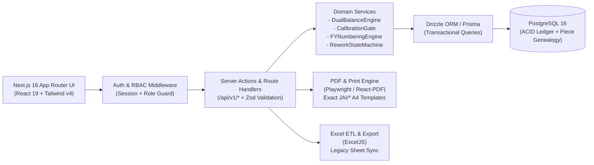

# System Architecture, RBAC & API Specification

> **Document ID:** `DOC-05`  
> **Aligned Workspace Stack:** Next.js `16.4.6` (App Router) · React `19.3.0` · TypeScript `^5` · Tailwind CSS v4 (`@tailwindcss/turbopack 4.3.3`) · PostgreSQL 16+  
> **Note (`AGENTS.md` Rule):** Before implementing code in `src/`, consult `node_modules/next/dist/docs/` for Next.js 16–specific App Router APIs (`async` `params`/`searchParams`/`cookies`/`headers`, caching semantics, and server actions).

---

## 1. High-Level Technical Architecture



### Technology Decisions
1. **Modular Monolith in Next.js 16**: Best fit for a single-plant precision job-work SME (~10–30 concurrent internal users on shop-floor tablets, QA stations, and office PCs)—zero microservice overhead, strict ACID PostgreSQL transactions for stock & serial balances.
2. **PDF Certificate Fidelity**: Use HTML/CSS print templates rendered server-side via **Playwright (Headless Chromium)** or `@react-pdf/renderer` so printed Hydro (`JAI/HYD/*`), LPT (`JAI/LPT/*`), PDI (`JAI/IR/*`), First Piece (`JAI/INPIR/*`), and Delivery Challans match existing ISO-audited `JAI/*` letterheads down to the millimeter.
3. **Excel Interoperability (`ExcelJS`)**: Customers/management expect clean Excel exports of `KSB DETAILS` (`JAI/ST/008`), `JSONS PO ` (`JAI/ST/008A`), and `MONTH WISE BALANCE QTY`, plus one-time migration import of 2026–2027 sheets.

---

## 2. Role-Based Access Control (RBAC) Matrix

| Role | Modules & Key Permissions | Restricted Actions (Hard Blocks) |
| :--- | :--- | :--- |
| **`ADMIN` (Director / Owner)** | Full CRUD across Masters, Rates, Financials (`WIP ₹`), User/Role admin, Audit logs, Override locks (with reason code) | None (all overrides logged immutably) |
| **`SUPERVISOR` (Plant / Production)** | PO registration, Priority (`P1`/`P2`/`P3`/`URGENT`), Split Flange confirmation, WR/Throttle Kit assignment, Job Card & Machine scheduling, Rework dispatch | Cannot alter Calibration records or certify NDT (`LPT`) |
| **`STORE_DISPATCH` (Stores & Logistics)** | Inward batch logging, Heat/RT/PC entry, Delivery Challan generation (`YY/NNN`), Non-Billable Return Challans (`NB-YY/NNN`) | Cannot generate Delivery Challan unless `PDI_PASSED` (and Hydro/LPT passed where required) |
| **`QA_NDT_ENGINEER` (Quality & NDT Level II)** | Master Templates (`INPIR`/`IR`/`DE`/`TE`), PDI sign-off, Hydro Test Cert (`JAI/HT/001`), LPT Cert (`JAI/DP/001`), Instrument Calibration updates (`JAI/CAL/001`), Defect disposition | Cannot delete finalized certificates (must issue Revision / Cancel note); cannot alter commercial PO Rates |
| **`OPERATOR` (CNC / VMC Shop Floor)** | View assigned Job Cards, enter First Piece observations (`INPIR`), log Machining stage completion, report casting defect (`BH`/`Crack`/`Less Matl`) | Cannot view commercial Rates/Billing; cannot approve PDI or Dispatch |
| **`ACCOUNTS` (Billing & Finance)** | Read-only PO Rates, Amount Received/Dispatched/Balance, Monthly Dispatch Value, NB Return Audit, Excel/Tally exports | Cannot edit QC test values or shop-floor piece status |

---

## 3. Financial-Year Concurrency-Safe Document Numbering Engine

Indian Financial Year runs **April 1 (`YYYY`) to March 31 (`YYYY+1`)**, formatted as `YYYY-YY` (e.g., `2026-27`) or short `YY` (`26`).

```sql
CREATE TABLE document_sequences (
    doc_type        VARCHAR(32) NOT NULL,  -- HYD, LPT, PDI, DC, NB_DC, INPIR
    financial_year  VARCHAR(9) NOT NULL,   -- e.g. 2026-27 (or GLOBAL for INPIR)
    last_number     INT NOT NULL DEFAULT 0,
    PRIMARY KEY (doc_type, financial_year)
);
```

Generated inside PostgreSQL `SELECT ... FOR UPDATE` transaction at **Finalization** (not Draft creation, avoiding gaps):

| Document Type | Output Format Example | FY Reset? |
| :--- | :--- | :---: |
| **Delivery Challan (Regular)** | `26/315` (`{yy}/{seq:03d}`) | Yes (Apr 1) |
| **Non-Billable Return Challan** | `NB-26/010` (`NB-{yy}/{seq:03d}`) | Yes (Apr 1) |
| **PDI Inspection Report** | `2026-27/293` (`{fy}/{seq:03d}`) | Yes (Apr 1) |
| **Hydro Test Certificate** | `JAI/HYD/2026-27/001` (`JAI/HYD/{fy}/{seq:03d}`) | Yes (Apr 1) |
| **LPT Test Certificate** | `JAI/LPT/2026-27/394` (`JAI/LPT/{fy}/{seq:03d}`) | Yes (Apr 1) |
| **First Piece Template ID** | `JAI/INPIR/051` (Sequential master ID; batch run links to lot) | No (Master) |

---

## 4. Core REST / Server Action API Contracts

All mutations use Zod schema validation, return `{ ok: true, data }` or `{ ok: false, error: { code, message, fieldErrors } }`, and execute inside database transactions.

### 4.1 Procurement & Inward Endpoints
- `GET /api/v1/po-lines` — Filterable by `flowType` (`DIRECT` | `FOUNDRY_MEDIATED`), `partyId`, `requiredMonth`, `hasPendingBalance`, `search` (PO No / Heat No / IN Code / Drawing). Returns dual-balance metrics (`balAtJai`, `balFromFoundry`, `wipAmountInr`).
- `POST /api/v1/po-headers` — Creates KSB PO + line items (and optional Foundry intermediary assignment).
- `POST /api/v1/inward-batches` — Logs incoming raw casting challan (`inwardChallanNo`, `receivedQty`, array of `{ serialNo, heatNo, rtNo, patternCode, flangeStandardId }`).
  - *Validation*: For `FOUNDRY_MEDIATED`, warns/blocks if `SUM(received) > ksb_ordered_qty` unless over-supply tolerance flag is set.
- `PATCH /api/v1/pieces/[id]/flange` — Confirms deferred flange standard (`WILL BE INFORM LATER` -> `DIN 2533 PN 16`) per individual piece, moving status out of `FLANGE_HOLD`.

### 4.2 Production, Kits & Rework Endpoints
- `PATCH /api/v1/pieces/[id]/kit` — Updates Wear Ring / Throttle Bush availability (`isAvailable`, `kitInCode`, `fittedDate`). Unlocks `KIT_PENDING -> READY_FOR_MACHINING`.
- `POST /api/v1/pieces/[id]/machining` — Logs machine assignment, setup start/completion, and execution parameters (`taperSize`, `drillHoles`, `connectionDrilling`).
- `POST /api/v1/pieces/[id]/rework` — Logs casting defect (`BLOW_HOLE`, `CRACK`, `HYDRO_LEAK`, `LESS_MATL`), `disposition`, and `isInHouseWeld`. Auto-increments `repair_cycle_count` (flags `TWICE REPAIRING` if `>= 2`).
- `PATCH /api/v1/rework/[id]/complete` — Records `weldCompletedDate` / `reworkMachinedDate`, transitions piece to `MACHINING_COMPLETE` (forcing fresh LPT + Hydro verification if pressure component).

### 4.3 Quality, Testing & Calibration Endpoints
- `GET /api/v1/instruments/available?category=PRE&minMaxRange=132.5` — Returns ONLY `ACTIVE` gauges with `cal_due_date >= CURRENT_DATE` and sufficient pressure range.
- `POST /api/v1/reports/inspection` — Creates/submits First Piece (`INPIR`) or PDI (`IR`/`DE`/`TE`) report across `[1..N]` selected pieces. Auto-evaluates numeric tolerances (`observed_numeric` between `[nominal + tol_minus, nominal + tol_plus]`).
- `POST /api/v1/certificates/hydro` — Auto-looks up `hydro_pressure_rules`, locks chosen calibrated pressure gauge (`JAI/PRE/*`), saves test outcome per serialized piece, issues `JAI/HYD/YYYY-YY/NNN`.
- `POST /api/v1/certificates/lpt` — Validates active non-expired Cleaner/Penetrant/Developer batches, logs per-piece `OK` vs `RI`/`LI` indications, auto-triggers `rework_logs` on any failed piece.

### 4.4 Dispatch, Returnables & Analytics Endpoints
- `POST /api/v1/challans` — Accepts `{ challanKind, consigneePartyId, pieceIds[] }`.
  - *Hard Gate Checks*:
    - If `JOB_WORK_REGULAR`: Every piece in `pieceIds` must have `PDI_PASSED`, plus `HYDRO_PASSED` (if `is_pressure_part`), plus `LPT_PASSED` (if `CL2B` or post-weld repair), plus `flange_confirmed = true`, plus WR/Throttle fitted (if required).
    - Auto-generates consolidated multi-PO reference summary and per-Heat quantity grouping (`Heat E 13972 - 1 NOS`, etc.).
- `GET /api/v1/analytics/monthly-dispatch-matrix` — Replicates `Sheet1` (`MONTH WISE BALANCE QTY`).
- `GET /api/v1/analytics/yearly-rework` — Replicates `YEARLY REWORK PERCENTAGE` by FY, Size, Material, and Defect Type.
- `GET /api/v1/pdfs/[docType]/[id]` — Streams print-ready A4 PDF (`Delivery Challan`, `PDI`, `First Piece`, `Hydro`, `LPT`).

---

## 5. Automated Background Alerts & Daily Jobs

Triggered via scheduled worker / daily dashboard digest:
1. **Calibration Expiry Alert**: Emails/badges QA Team at `30 days`, `15 days`, `7 days`, and `0 days` before `cal_due_date` on any `JAI/*` instrument.
2. **LPT Chemical Shelf-Life Alert**: Flags Cleaner/Penetrant/Developer batches within 30 days of `expiry_date`.
3. **KSB Monthly Delivery SLA Warning**: Highlights any PO line with `BAL QTY > 0` within 7 days of `ksb_required_month` or overdue.
4. **Foundry Supply Gap Alert**: Highlights `FOUNDRY_MEDIATED` lines where `QTY BAL FROM FOUNDRY > 0` and KSB due month is `< 15 days` away.
5. **Kit / Flange Bottleneck Alert**: Lists castings sitting in `FLANGE_HOLD` or `KIT_PENDING` (`Waiting WR/Throttle`) for `> 3 days`.
